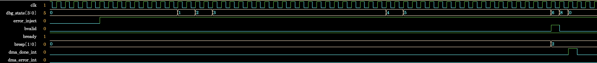
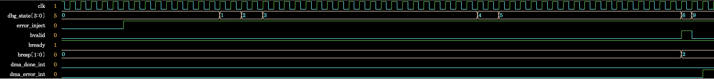

# Debugging the AXI4 BRESP Error-State Transition

## Overview

In Step 3, the DDR memory model returned `SLVERR` on the B channel. The log and FSM logic showed why
the DUT entered `S_DONE`, and I corrected the next-state condition.

## Reproduction

After the S3-2 scenario transmitted 64 bytes of write data, the DDR memory model returned
`BRESP=2'b10`. Although the DUT detected the write-response error, it transitioned to `S_DONE` rather
than `S_ERROR` on the next clock.

```text
Expected: S_WR_RESP → S_ERROR
Actual:   S_WR_RESP → S_DONE → S_IDLE
```

- Failure waveform: [`bresp_error_path_failure.png`](../images/step3/bresp_error_path_failure.png)



Before the fix, the normal-completion state and completion interrupt occurred immediately after
`BRESP=10` was detected. STATUS was `0x00000306`, meaning `error_code=0x3`, `error=1`, and `done=1`.

```text
DMA: WRITE ERROR - BRESP=10
DMA State: WRITE_RESP
DMA: TRANSFER COMPLETED - Total 64 bytes
DMA State: COMPLETE
DMA completion interrupt received!
REG[0x04] -> 0x00000306
```

- Reproduction simulation log (after W-channel fixes and before the BRESP fix):
  [`step3_bresp_error_path_failure.log`](../../runs/debug/step3_bresp_error_path_failure.log)

## Cause and Fix

Before the fix: [`baseline/design.sv`](../../baseline/design.sv#L514)

```systemverilog
S_WR_RESP: if (m.bvalid && m.bready) begin
    if (stat.error)
        nxt = S_ERROR;
    else if (bytes_left > 0)
        nxt = S_NEXT;
    else
        nxt = S_DONE;
end
```

The `S_WR_RESP` sequential logic sets `stat.error` with a nonblocking assignment at the BRESP
handshake. At the same time, the next-state combinational logic reads the old `stat.error=0`, so it
selects the normal-completion path even though the current response is SLVERR.

After the fix: [`rtl/dma_controller.sv`](../../rtl/dma_controller.sv#L402)

```systemverilog
S_WR_RESP: if (m.bvalid && m.bready) begin
    if (m.bresp != 2'b00)
        nxt = S_ERROR;
    else if (bytes_left > 0)
        nxt = S_NEXT;
    else
        nxt = S_DONE;
end
```

The next-state decision now checks `BRESP` directly at the current handshake. Existing sequential
logic continues to record `stat.error` and `stat.error_code`, preserving MMIO STATUS visibility.

## Fix and Re-Verification Results

After the fix, the FSM transitions `S_WR_RESP(6) → S_ERROR(9)` immediately after detecting
`BRESP=10`, and an error interrupt replaces the completion interrupt. STATUS becomes `0x00000304`,
meaning `error_code=0x3`, `error=1`, and `done=0`.

- Fixed waveform: [`bresp_error_path_fixed.png`](../images/step3/bresp_error_path_fixed.png)



| Check | Before Fix | After Fix |
|---|---|---|
| FSM transition | `S_WR_RESP → S_DONE → S_IDLE` | `S_WR_RESP → S_ERROR` |
| Interrupt | Completion interrupt | Error interrupt |
| STATUS | `0x00000306` | `0x00000304` |
| Error code | `0x3` | `0x3` |
| Done | `1` | `0` |
| 64-byte data comparison | 16 words match | 16 words match |

- Post-fix simulation log: [`step3_simulation.log`](../../runs/step3_simulation.log)

SLVERR is returned after write data has been stored in memory, so matching all 16 source and
destination words while the DUT enters the error state is the intended behavior. The single error in
the UVM summary is the Driver's report of STATUS `error=1` and does not indicate failure of the BRESP
error-state-transition fix.
