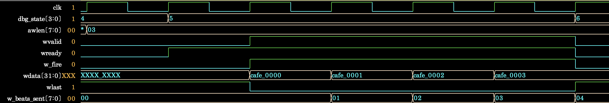
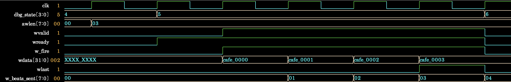

# Debugging AXI4 W-Channel WLAST Timing

## Overview

During Step 4 functional coverage closure, transaction and FSM coverage reached 100%, but AXI-event
coverage item `cp_wlast_awlen` remained at 33.33%. Analysis of the failing log and four-beat write-
burst waveform showed that the DUT asserted `WLAST` after the final data handshake, and the issue was
corrected.

## Reproduction

The first run reached `cp_awlen=100%`, confirming execution of all 1-, 4-, and 16-beat bursts. In
contrast, `cp_wlast_awlen`, which samples `WVALID && WREADY && WLAST` for the same burst lengths,
remained at 33.33%. AXI-event coverage ended at 92.59%, overall coverage at 97.53%, and the final test
failed. This indicated a WLAST behavior problem rather than a missing scenario, so the shortest
multi-beat case—the S1-3 four-beat waveform—was analyzed.

- Coverage-gap reproduction log:
  [`step4_wlast_coverage_gap.log`](../../runs/debug/step4_wlast_coverage_gap.log)
- Failure waveform: [`wlast_timing_failure.png`](../images/step4/wlast_timing_failure.png)



In the S1-3 four-beat waveform with `AWLEN=3`, `WVALID`, `WREADY`, and `w_fire` are all 1 when the
final data `CAFE0003` handshakes, but `WLAST` is 0. `WLAST` becomes 1 only in the next cycle, after the
FSM has entered `S_WR_RESP` and `WVALID=0`, confirming that WLAST is missing from the final handshake.

## Cause and Fix

WLAST expression before the fix: [`baseline/design.sv`](../../baseline/design.sv#L414)

```systemverilog
m.wlast <= (w_beats_sent == burst_len_m1);
```

While outputting the next `WDATA`, the DUT calculated `WLAST` from the current beat number. `WLAST`
stayed low when the fourth beat was accepted. It went high one clock cycle later, after `WVALID` had
gone low.

After the fix: [`rtl/dma_controller.sv`](../../rtl/dma_controller.sv#L292)

```systemverilog
else if (m.wvalid) begin
    if (m.wready) begin
        m.wdata <= wdata_hold;
        m.wlast <= ((w_beats_sent + 1) == burst_len_m1);
    end
end
```

The final-beat calculation now uses `w_beats_sent + 1`, matching the next `WDATA`. The first-beat
expression remains unchanged so one-beat bursts continue to work correctly.

## Fix and Re-Verification Results

After the fix, `WLAST=1` occurs in the same cycle as the final `CAFE0003` handshake in the same four-
beat region. In the next cycle, `WVALID=0` and `WLAST=0`, and the FSM correctly enters `S_WR_RESP`.

- Fixed waveform: [`wlast_timing_fixed.png`](../images/step4/wlast_timing_fixed.png)



| Check | Before Fix | After Fix |
|---|---:|---:|
| `cp_wlast_awlen` | 33.33% | 100.00% |
| AXI-event coverage | 92.59% | 100.00% |
| Overall coverage | 97.53% | 100.00% |
| Checked transactions | 37 / 37 | 37 / 37 |
| Coverage closure | Not achieved | Achieved |
| Final result | FAILED | PASSED |

- Post-fix simulation log: [`step4_simulation.log`](../../runs/step4_simulation.log)

The rerun reaches 100% for every coverpoint and cross, with 20 expected/actual UVM errors and zero
warnings or fatals. The 20 errors in the UVM summary are expected results from the size-error and
BRESP-SLVERR negative tests.
