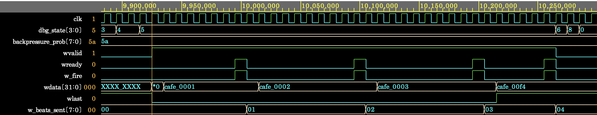
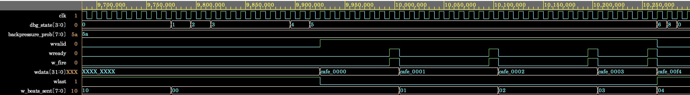
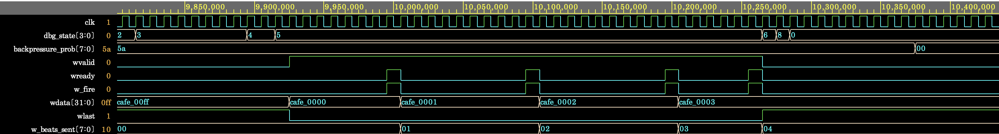

# Debugging an AXI4 W-Channel Data Mismatch Under Backpressure

## Overview

Applying AXI4 W-channel backpressure to the existing Step 2 scenarios in Step 3 caused source and
destination data to differ. Log and waveform analysis identified and corrected causes in the DUT's
WDATA-update condition and FIFO-prefetch condition.

## Reproduction

S1 passed without backpressure, but probabilistic backpressure caused data mismatches in S2 and S3-1.

| Scenario | Backpressure Probability | Result Before Fix |
|---|---:|---:|
| S2 — 1024B transfer | 10% | 25 mismatches, 1 unknown |
| S3-1 — 16B transfer | 90% | 4 mismatches, 0 unknowns |

- Pre-fix simulation log: [`step3_w_payload_failure.log`](../../runs/debug/step3_w_payload_failure.log)
- Failure waveform: [`axi_w_payload_stability_violation.png`](../images/step3/axi_w_payload_stability_violation.png)



The S3-1 source-read data was correct from `CAFE0000` through `CAFE0003`, but the WDATA waveform also
showed `CAFE00F4`, data from the previous burst.

```text
Expected accepted beats:     CAFE0000 → CAFE0001 → CAFE0002 → CAFE0003
Values observed on WDATA:    CAFE0000 → CAFE0001 → CAFE0002 → CAFE0003 → CAFE00F4
Beats accepted at handshakes: CAFE0001 → CAFE0002 → CAFE0003 → CAFE00F4
```

Backpressure repeats while `WVALID=1` in the waveform. No handshake occurs in any `WREADY=0`,
`w_fire=0` interval, so `WDATA` should remain stable. Instead, it continues to update from
`CAFE0000 → CAFE0001`, `CAFE0001 → CAFE0002`, `CAFE0002 → CAFE0003`, and
`CAFE0003 → CAFE00F4`.

Each data change during a stall violates the AXI4 payload-stability requirement. At the following
`w_fire`, the already advanced value is accepted, shifting the transmitted data by one beat and
accepting `CAFE00F4` on the final handshake.

(The short `*0` region to the left of `CAFE0001` is the initially output `CAFE0000`.)

## Cause and Fix

### 1. AXI4 W-Payload Update-Condition Bug

Before the fix: [`baseline/design.sv`](../../baseline/design.sv#L412)

```systemverilog
else if (m.wvalid) begin
    m.wdata <= wdata_hold;
    m.wlast <= (w_beats_sent == burst_len_m1);
end
```

The original code updates the W payload whenever `WVALID=1`, regardless of `WREADY`. AXI4 requires
the payload to remain stable while `WVALID=1` and `WREADY=0`, so advancing to the next data before a
handshake is a protocol violation.

After the fix: [`rtl/dma_controller.sv`](../../rtl/dma_controller.sv#L289)

(The following code reflects only the Step 3 W-payload update-condition fix, before the Step 4 WLAST-
timing fix was applied.)

```systemverilog
else if (m.wvalid) begin
    if (m.wready) begin
        m.wdata <= wdata_hold;
        m.wlast <= (w_beats_sent == burst_len_m1);
    end
end
```

Adding the `WREADY` condition advances to the next payload only when a handshake occurs and preserves
the current value during backpressure.

### 2. FIFO-Prefetch Range Bug

Before the fix: [`baseline/design.sv`](../../baseline/design.sv#L426)

```systemverilog
if (w_beats_sent != burst_len_m1)
    wdata_hold <= fifo[rd_ptr + 2];
```

On the third beat of a four-beat burst, the final data in `fifo[3]` is already prepared, but the old
condition still prefetches `fifo[4]`. S3-1 updates only `fifo[0:3]`, so `fifo[4]` retained
`CAFE00F4` from the previous S2 burst. Leaving FIFO storage uncleared is not itself a problem; the
cause was an access beyond the valid-data range of the current burst.

After the fix: [`rtl/dma_controller.sv`](../../rtl/dma_controller.sv#L305)

```systemverilog
if ((w_beats_sent + 1) < burst_len_m1)
    wdata_hold <= fifo[rd_ptr + 2];
```

The condition now prefetches only when subsequent data at `rd_ptr + 2` is actually required.

## Fix and Re-Verification Results

### After Fixing the W-Payload Update Condition

After fixing the AXI4 W-payload update-condition bug, `WDATA` remains stable under backpressure and
the S2/S3-1 data mismatches disappear. However, the unnecessarily prefetched `CAFE00F4` still appears
on `WDATA` after the final handshake; because `WVALID=0`, it is not actually transferred.

- Waveform: [`axi_w_payload_fixed.png`](../images/step3/axi_w_payload_fixed.png)



### After Also Fixing the FIFO-Prefetch Range

After the FIFO-prefetch range bug is fixed, the final `WDATA` remains `CAFE0003`. The rerun log records
Scoreboard PASS for all four transactions, 340 matching words, and four expected transactions.

- Waveform: [`axi_w_payload_prefetch_fixed.png`](../images/step3/axi_w_payload_prefetch_fixed.png)



| Check | Before Fix | After Fix |
|---|---:|---:|
| Overall data comparison | 29 mismatches, 1 unknown | 340 matches, 0 mismatches/unknowns |
| WDATA stability under backpressure | Failed | Correct |
| Unnecessary `fifo[4]` prefetch | Occurred | Removed |

- Post-fix simulation log: [`step3_simulation.log`](../../runs/step3_simulation.log)

The single error in the UVM summary is the intentionally injected BRESP SLVERR in S3-2 and does not
indicate a re-verification failure of the W-payload or FIFO-prefetch fixes.
